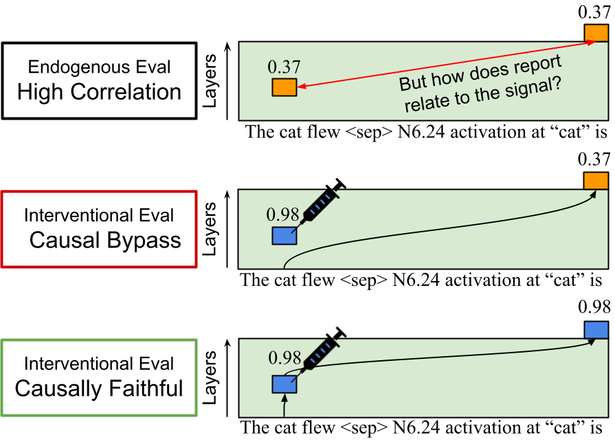

# low-level-introspection

<p align="left">
  <a href="">
    
  </a>
  <a href="https://github.com/PootieT/low-level-introspection/blob/main/LICENCE">
    
  </a>
</p>

This repo contains the code to reproduce the paper `Interventional Training Reduces Causal Bypass in In-Context Introspection` on [Arxiv]() or [OpenReview](https://openreview.net/forum?id=5P7dVpGNPO). (In submission).

<p align="center">
  
</p>

# TL;DR
Investigating whether LMs can introspect low level signals (natively or with finetuning), and if they can, how do they do it?

## Why?
Introspection research need a better evaluation task that is grounded and verifiable. Existing evaluations focuse on
either **endogenous** or **interventional** setting, never both. We argue a causally faithful introspector (vs. a causally bypassing) introspector
would have to succeed in both settings. 

Low-level signals are 
the perfect target because they are:
1. **Grounded**: They are grounded in the transformer architecture, with ground-truth labels in endogenous and interventional evaluation settings.
2. **Scalable**: You can scale this training across training data, architecture, and signal types, and trade computes for insights
3. **Locale-specific**: We know exactly which layer/position/signal index are the signals from, and can observe correlation of performance across locales.

## Findings
1. Models finetuned on output-only supervision (SFT) results in high endogenous but mostly low interventional eval, indicating causal bypass. Early layer and late token positions are easier to introspect faithfully.
2. We introduced a joint loss to fix interventional eval via interventional training. This improves interventional while maintaining endogenous performance.
3. Such training can generalize to unseen token positions, but not across layers or signal index. Each signal source has to be modified for it to be introspectable.
4. Mechanistically, attention heads responsible for either metrics overlap physically and functionally, but they are not exact.

Below are the instructions for how to use our repo.

## Signal Types
Currently we have the following types of signals written for training:
- MLP neuron (after non-linearity, post gate projection, before multiplication with up projection)
- Attention logit (pre-softmax `q.k/sqrt(d_head)`, after RoPE) at one
  `(layer, head, destination token, source token)` cell -- named `A<layer>.<head>@<src_offset>`
- Attention weight (post-softmax `p = softmax(z + mask)`) at the same kind of cell -- named
  `P<layer>.<head>@<src_offset>`
- SAE feature

Other interesting signals one could think about extending:
- residual stream signals:
- lens results: logit lens, J-lens, etc.
- natural language autoencoders (NLA) generations

## Repo Structure
Run everything from the repo root, as `python <folder>/<script>.py`.

| Folder                  | What is in it                                                                                                                               |
|-------------------------|---------------------------------------------------------------------------------------------------------------------------------------------|
| `data_prep/`            | build experiment configs, cache signals into datasets, pick neurons / SAE features                                                          |
| `trainers/`             | train introspectors (SFT, with intervention, joint) and SAE detectors                                                                       |
| `evals/`                | evaluate trained introspectors: length / OOD / neuron generalization, LM degradation, benchmarks, prompted baselines                        |
| `mechanistic_analysis/` | how the introspector works: circuit tracing, head knockout / ablation, attribution, probes                                                  |
| `plotters/`             | figures and tables from finished runs                                                                                                       |
| `src/introspector/`     | shared library: configs, signal extraction, models, training utilities                                                                      |
| `scripts/`              | shell drivers for every experiment (index in `scripts/README.md`)                                                                           |
| `tests/`                | unit and smoke tests (`python -m pytest tests/`), plus model-backed sanity checks (`tests/validate_*.py`, `tests/probe_cache_alignment.py`) |
| `utils/`                | housekeeping: checkpoint cleanup, `migrate_old_paths.py` for branches from before the reorganization (see `MIGRATION.md`)                 |
| `outputs/plots/`        | default plotting outputs / aggregated analysis across runs                                                                                  |
| `outputs/runs/`         | individual training run caching directories                                                                                                 |

## Important Files
- `data_prep/generate_experiment_config.py`, this will take in arguments relevant to the experiment, and spit out a training json
  config, which can be consumed by trainer for reproducible experiments.
- `data_prep/cache_signals.py` this will take in the json file, and cache the signals into dataset files.
- `trainers/train_introspector.py` trains introspector with regular SFT objectives
- `trainers/train_introspector_with_intervention.py` trains introspector with intervention during training.

## Example Experiments
Checkout `.sh` files in `scripts/`; `scripts/README.md` lists what each one runs.

Every experiment has the same three steps, run from the repo root on one GPU:
1. write a config: `data_prep/generate_experiment_config.py`
2. cache the signal values for that config: `data_prep/cache_signals.py`. This needs the GPU
   and is skipped if the cache already exists.
3. train, then evaluate: `trainers/train_introspector_joint.py` (neurons, attention) or
   `trainers/train_sae_detector_joint.py` (SAE features).

`--joint-loss-weight W` is the weight on the endogenous loss; the interventional loss gets
`1 - W`. `W=1.0` is the SFT baseline and `W<1` is the joint loss from the paper. Both
endogenous and interventional test metrics are written to `outputs/runs/<group>/<name>/`
whatever `W` is.

To train a `Llama-3.2-1B` model to introspect a single neuron `N6.115` (fixed token position), you can do:
```commandline
CONFIG=experiment_configs/examples/llama1b_N6.115_pos-1.json
python data_prep/generate_experiment_config.py \
    --experiment-name llama1b_N6.115_pos-1 --model meta-llama/Llama-3.2-1B \
    --train-dataset allenai/c4 --train-dataset-split train --train-max-samples 300000 \
    --dev-max-samples 200 --dev-offset-from-train 1000000 \
    --test-dataset allenai/c4 --test-dataset-split validation --test-max-samples 3000 \
    --hf-data-kwargs '{"config": "en", "streaming": true}' --max-seq-length 32 \
    --train-signals N6.115 --test-signals N6.115 \
    --train-token-selector -1 --test-token-selector -1 --precision 3 \
    --use-regressor --intervention-signal-distribution extreme --intervention-extreme-scale 10 \
    --train-batch-size 32 --eval-batch-size 128 --num-epochs 1 --learning-rate 5e-5 \
    --lora-r 16 --lora-alpha 32 --lora-dropout 0.0 --bf16 --save-steps 0 \
    --cache-dir data --output-dir outputs/runs/examples --output $CONFIG
python data_prep/cache_signals.py --config $CONFIG
python trainers/train_introspector_joint.py --config $CONFIG \
    --joint-loss-weight 0.01 --kl-anchor-target 0.1 --force-drift-eval
```
These are the main grid's settings (Section 4). `--kl-anchor-target 0.1` holds the
language model's KL to its base at 0.1 nats/token; drop it for the unanchored ceiling.
`--force-drift-eval` checks that the cache lines up with the live model: look for
`alignment OK`. Add `python evals/score_lm_degradation.py --config $CONFIG` to measure
the language-model cost.

To train a `Qwen3-8B` model to introspect multiple token positions for neuron `N1.55` and `N12.4201`, you can do:
```commandline
CONFIG=experiment_configs/examples/qwen3_8b_N1.55_N12.4201_pos-8to-1.json
python data_prep/generate_experiment_config.py \
    --experiment-name qwen3_8b_N1.55_N12.4201_pos-8to-1 --model Qwen/Qwen3-8B-Base \
    --train-dataset allenai/c4 --train-dataset-split train --train-max-samples 300000 \
    --dev-max-samples 200 --dev-offset-from-train 1000000 \
    --test-dataset allenai/c4 --test-dataset-split validation --test-max-samples 3000 \
    --hf-data-kwargs '{"config": "en", "streaming": true}' \
    --max-seq-length 32 --min-seq-length 32 \
    --train-signals N1.55,N12.4201 --test-signals N1.55,N12.4201 \
    --train-token-selector=-8:-1 --test-token-selector=-8:-1 \
    --prompt-type prompt_with_token_index --precision 3 \
    --use-regressor --intervention-signal-distribution extreme --intervention-extreme-scale 10 \
    --train-batch-size 16 --gradient-accumulation-steps 2 --eval-batch-size 128 \
    --num-epochs 1 --learning-rate 5e-5 \
    --lora-r 16 --lora-alpha 32 --lora-dropout 0.0 --bf16 --save-steps 0 \
    --cache-dir data --output-dir outputs/runs/examples --output $CONFIG
python data_prep/cache_signals.py --config $CONFIG
python trainers/train_introspector_joint.py --config $CONFIG \
    --joint-loss-weight 0.01 --kl-anchor-target 0.1 --force-drift-eval
```
One run learns both neurons. Each text gets one position drawn uniformly from the last 8
tokens, so the prompt has to name it (`prompt_with_token_index`). Write a range selector
with `=` (`--train-token-selector=-8:-1`), because a value starting with `-` would
otherwise be read as a flag. `--min-seq-length 32` makes every text exactly 32 tokens, so
a negative position always means the same token. Qwen's base checkpoints have the `-Base`
suffix. The LR is the one the Qwen3-8B LR sweep picked, at an effective batch of 32
(16 x 2). Per-neuron metrics go to `endogenous_test_by_signal_endogenous.csv`.

To train a `Llama-3.2-3B` model to introspection attention head `A7.5`, fixing destination token at `t=-1`, you can do:
```commandline
CONFIG=experiment_configs/examples/llama3b_A7.5@-3_pos-1.json
python data_prep/generate_experiment_config.py \
    --experiment-name llama3b_A7.5@-3_pos-1 --model meta-llama/Llama-3.2-3B \
    --train-dataset allenai/c4 --train-dataset-split train --train-max-samples 300000 \
    --dev-max-samples 200 --dev-offset-from-train 1000000 \
    --test-dataset allenai/c4 --test-dataset-split validation --test-max-samples 3000 \
    --hf-data-kwargs '{"config": "en", "streaming": true}' \
    --max-seq-length 32 --min-seq-length 32 \
    --train-signals A7.5@-3 --test-signals A7.5@-3 \
    --train-token-selector -1 --test-token-selector -1 --precision 3 \
    --use-regressor --intervention-signal-distribution extreme --intervention-extreme-scale 10 \
    --train-batch-size 32 --eval-batch-size 128 --num-epochs 1 --learning-rate 5e-5 \
    --warmup-ratio 0.03 --lr-scheduler-type cosine \
    --lora-r 16 --lora-alpha 32 --lora-dropout 0.0 --bf16 --save-steps 0 \
    --cache-dir data --output-dir outputs/runs/examples --output $CONFIG
python data_prep/cache_signals.py --config $CONFIG
python trainers/train_introspector_joint.py --config $CONFIG \
    --joint-loss-weight 1.0 --force-drift-eval
```
`A7.5@-3` is the pre-softmax attention logit of layer 7, head 5, from the destination
token (the token selector, here the last token) to the token 3 positions before it. To
read several source offsets, cache them together
(`--train-signals A7.5@-1,A7.5@-3,A7.5@-7`) and train one run per offset with
`--signal-filter A7.5@-3`. `data_prep/cache_signals.py` refuses an attention config whose length
floor cannot reach every offset; the grids set `--min-seq-length` equal to
`--max-seq-length`, so every source offset is the same token in every text. This is the attention-logit
grid's recipe (`scripts/attention/`), which trains endogenously only (`W=1.0`); with a
3B model it is untested. For the joint loss on attention, the paper uses post-softmax
weights (`P7.5@-3`) with the readout and injection of
`scripts/attention_weight/paper/2-2_grid_endogenous_logistic_norm_dev_prob_uniform.sh`.
Before any `W<1` run on logits, read `scripts/README.md` on choosing
`--intervention-extreme-scale`.

To train a `Gemma-2-2B` model to introspect SAE features (pre-selected) at fixed token location, you can do:
```commandline
FEATURES=S9.1568,S9.4854,S9.4120,S9.978,S9.12408
for SIG in ${FEATURES//,/ }; do
  CONFIG=experiment_configs/examples/gemma2b_${SIG}_pos-1.json
  python data_prep/generate_experiment_config.py \
      --experiment-name gemma2b_${SIG}_pos-1 --model google/gemma-2-2b \
      --objective detection --detection-balance-pos-frac 0.5 \
      --intervention-signal-distribution extreme --intervention-extreme-scale 1 \
      --train-dataset allenai/c4 --train-dataset-split train --train-max-samples 150000 \
      --dev-max-samples 2000 --dev-offset-from-train 1000000 \
      --test-dataset allenai/c4 --test-dataset-split validation --test-max-samples 30000 \
      --hf-data-kwargs '{"config": "en", "streaming": true}' --max-seq-length 32 \
      --train-signals $FEATURES --test-signals $FEATURES --signal-filter $SIG \
      --train-token-selector -1 --test-token-selector -1 --precision 3 \
      --train-batch-size 32 --eval-batch-size 128 --num-epochs 1 --learning-rate 2e-5 \
      --warmup-ratio 0.03 --lr-scheduler-type cosine \
      --lora-r 16 --lora-alpha 32 --lora-dropout 0.0 --bf16 --save-steps 0.25 \
      --cache-dir data --output-dir outputs/runs/examples --output $CONFIG
  python data_prep/cache_signals.py --config $CONFIG
  python trainers/train_sae_detector_joint.py --config $CONFIG \
      --joint-loss-weight 0.9 --kl-anchor-target 0.1 --force-drift-eval
done
```
`S9.1568` is feature 1568 of the Gemma Scope 16k residual SAE at layer 9. These five are
the hand-judged layer-9 features (how they were chosen: `scripts/sae/README.md`). SAE
features are sparse, so the readout is binary detection ("active" / "inactive"), trained
on a 50/50 balanced set. Interventional training steers the feature on or off. All five
configs list the same features, so they share one cache, and `--signal-filter` picks
the feature each run trains on. `W=0.9` is the paper's SAE joint arm and `W=1.0` its SFT
arm. This needs `sae_lens`, which downloads the SAE weights on first use.

### Experiments and Figures in the paper
Here are the list of scripts corresponding to each paper section:

| Section | Training | Plotting |
|---|---|---|
| Section 3 (Main Grid SFT; Neuron) | `scripts/neuron/train_single_mlp_introspector_endogenous_sweep_layer_token.sh` | `plotters/compare_sft_vs_joint.py` (`heatmap_sft_*`) |
| Section 3 (Main Grid SFT; Attention) | `scripts/attention_weight/paper/1-1_grid_endogenous_logistic_norm_dev.sh`, then `2-1-0_reeval_1-1_empirical_prob.sh` for the interventional score | `plotters/plot_paper_sft_panel_c.py` |
| Section 3 (Main Grid SFT; SAE) | `scripts/sae/submit_sae_sweep.sh` (the `W=1.0` arm) | `plotters/plot_sae_sweep.py` |
| Section 4 (Main Grid Joint Loss; Neuron) | `scripts/neuron/train_single_mlp_introspector_joint_sweep_layer_token.sh` | `plotters/compare_sft_vs_joint.py` (`delta_*_vs_sft`) |
| Section 4 (Main Grid Joint Loss; Attention) | `scripts/attention_weight/paper/2-2_grid_endogenous_logistic_norm_dev_prob_uniform.sh` (`W=0.3`) | `plotters/plot_paper_joint_loss_panel_c.py` |
| Section 4 (Main Grid Joint Loss; SAE) | `scripts/sae/submit_sae_sweep.sh` (the `W=0.9` arm) | `plotters/plot_sae_sweep.py` (`delta_*_w0.9_vs_w1`) |
| Choosing the joint-loss weight `W` | `scripts/neuron/train_single_mlp_introspector_joint_weight_sweep.sh` | `plotters/plot_weight_sweep.py` |
| Section 5.1 (Neuron length generalization) | `scripts/neuron/train_single_mlp_introspector_length_generalization.sh` (joint) + `..._length_generalization_sft.sh` (SFT) | `plotters/plot_length_generalization.py --compare mlp_lengen:Joint mlp_lengen_sft:SFT` |
| Section 5.2 (Neuron layer generalization) | `scripts/neuron/train_single_mlp_introspector_layer_generalization.sh` | `plotters/plot_layer_generalization.py` |
| Section 5.3 (Neuron index generalization) | `scripts/neuron/train_single_mlp_introspector_neuron_generalization.sh` | `plotters/plot_neuron_generalization.py` |
| Mechanism: do the two evals use the same heads? | `scripts/neuron/score_head_knockout_joint_grid.sh` (on the Section 4 checkpoints; no training) | `plotters/plot_head_knockout.py`, `plotters/plot_knockout_head_gating.py` |
| Untrained prompted baseline | `scripts/neuron/score_prompt_baseline_layer_token.sh`, `scripts/sae/score_sae_prompt_baseline.sh` (no training) | `plotters/plot_prompt_baseline.py`, `plotters/plot_sae_prompt_baseline.py` |
| Model scale (Llama-3.2-3B / 3.1-8B, Qwen3) | `scripts/neuron/train_single_mlp_introspector_joint_lr_sweep.sh`, then `..._joint_sweep_layer_token_<model>_hyper_tuned.sh` | `plotters/plot_lr_sweep.py`, `plotters/compare_model_scaling.py` |
| Appendix L (SAE feature generalization) | `scripts/sae/build_featgen_pool_layer9.sh` -> `cache_sae_feature_generalization.sh` -> `train_sae_feature_generalization.sh` | `plotters/plot_sae_feature_generalization.py` |

Run plotters from the repo root once the runs are synced. Most read `outputs/runs/` and
write to `outputs/plots/`; the two `plot_paper_*` panels write to `paper_plots/`.


## Future Directions
- Change off-line training to online, refresh signal caches throughout training.
- Scale up experiments and move it to mid/pre-training, observe whether how this objective impacts representations and other task performances.
- Second order introspective tasks (i.e. "compute 1+1 but do it wrong if you detect neuron activation N2.12 > 0.5")
- Reversing the task (i.e. prompt model to change neuron activation)


## Citations
If you find our work or repo useful, please consider citing our paper!
```bibtex
@article{tang2026,
  title={Interventional Training Reduces Causal Bypass in In-Context Introspection},
  author={Tang, Zilu and Kim, Jongin and Sahin, Kerem and Atkinson, David and Mueller, Aaron and Wijaya, Derry},
  journal={arXiv preprint arXiv:XXXX.XXXXX},
  year={2026}
}
```

## AI Assistance Disclaimer
The repo is written with the help of Claude Code and OpenAI Models.
